# User flow: ATAs

Every path a person can take on `/atas` and `/atas/{id}`: what they see, what
they may do, what each field accepts, and what the screen answers when
something is refused. The behaviour is SPEC-0013's (screens) and SPEC-0002's
(rules); where this file and a spec disagree, the spec wins.

The screenshots under [`atas/`](atas/) were taken from the running application
on 13/10/2026, with fictional ATAs and fornecedores, in a 1440 px browser set
to pt-BR. A screenshot ages with the screen: retake it in the PR that changes
what it shows.

## Who can do what

| Action | gestor | servidor | auditor |
| --- | --- | --- | --- |
| See the list, the alerts and any ATA | ✓ | ✓ | ✓ |
| Cadastrar ATA | ✓ | — | — |
| Editar | ✓ | — | — |
| Ativar, Suspender, Retomar, Encerrar, Cancelar | ✓ | — | — |
| Registrar aditivo | ✓ | — | — |
| Registrar pedido de reajuste | ✓ | — | — |
| Delete an ATA | — | — | — |

A control a perfil may not use is not shown. The API refuses the action
anyway (`PERFIL_NAO_AUTORIZADO`), whatever the screen shows.

## Map

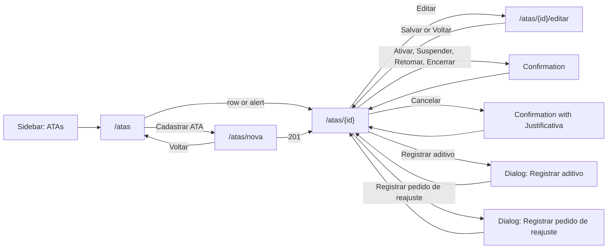

## The ATA's lifecycle

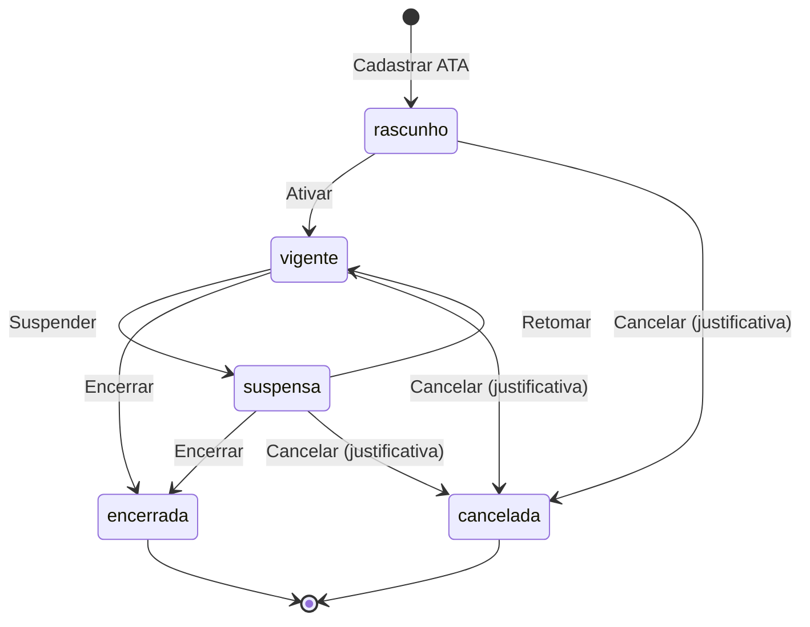

`Status` is the lifecycle above, changed only by a gestor. `Situação` is
derived from today's date and `Fim da vigência`, and nobody sets it:

| Situação | When |
| --- | --- |
| Vigente | More than 90 days before `Fim da vigência` |
| A vencer | 90 days or fewer before it |
| Vencida | After it |

The two are independent. A rascunho can read "Vigente" in Situação because its
dates are; an encerrada ATA can read "A vencer". The 90 days are configurable
(`ATA_ALERT_DAYS`).

---

## 1. Consult the list

Sidebar → **ATAs**.

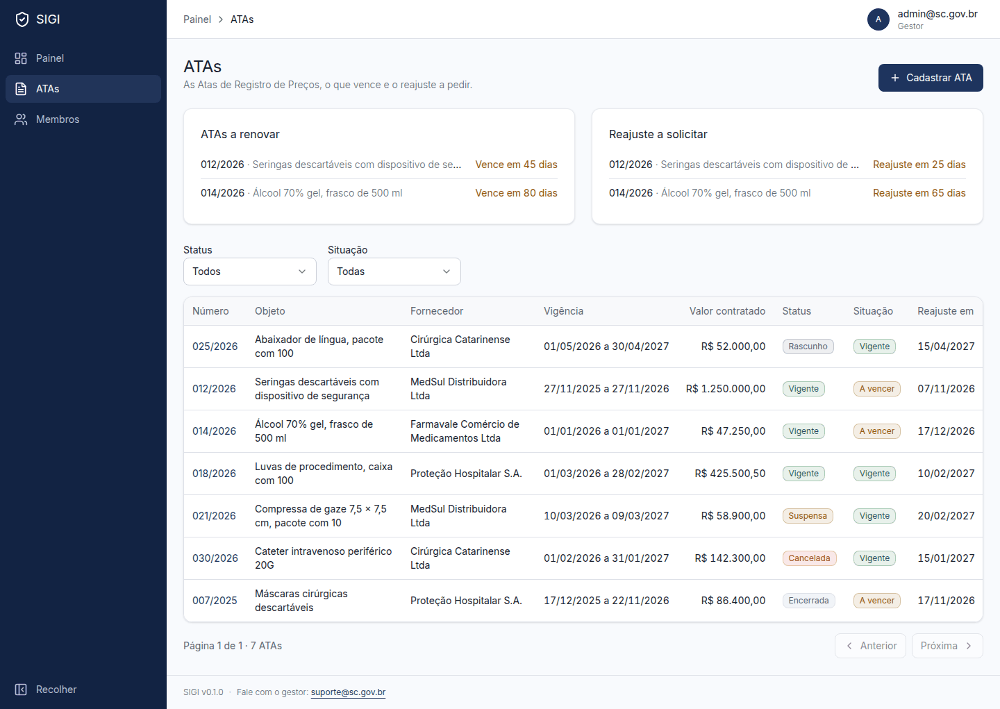

**What is on the page, top to bottom**

1. **Vencimentos e reajustes.** One list of what falls due, the most urgent
   first. Each row says its kind, the ATA's número and objeto, the date and the
   days left as a large figure ("45 dias", "hoje", or "há 3 dias" in red once
   past). Two kinds of row:
   - **Vencimento**: a vigente ATA whose vigência ends within 90 days, or has
     already ended, and that has no aditivo de prazo. Dated by Fim da vigência.
   - **Reajuste**: a vigente ATA whose reajuste date (one year after `Data do
     orçamento planilhado`) is within 90 days or past, with no pedido de
     reajuste recorded. Dated by the reajuste date. It leaves the list as soon
     as a pedido is recorded.

   An ATA due on both counts appears twice, once per kind. The five most urgent
   show; "Mostrar todos (N)" shows the rest. When nothing is due, the block is
   one line: "Nenhum vencimento ou reajuste próximo."
2. **Filters**, Status and Situação.
3. **The table**: Número, Objeto, Fornecedor, Vigência, Valor contratado,
   Status, Situação and Reajuste em, newest first, 25 per page.

Each row of either list opens that ATA. Which ATAs fall due is computed by the
API; the screen never decides it.

**Filter**

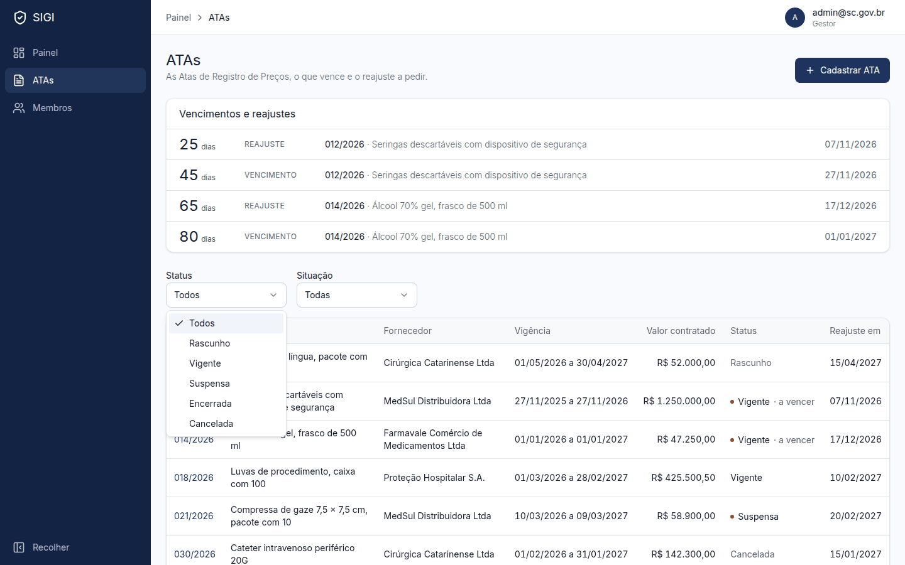

Choosing a value reloads the table from page 1. The filters and the page live in
the address (`/atas?status=vigente&situacao=a_vencer&pagina=2`), so a reload or
a shared link keeps them. **Limpar filtros** returns to the full list.

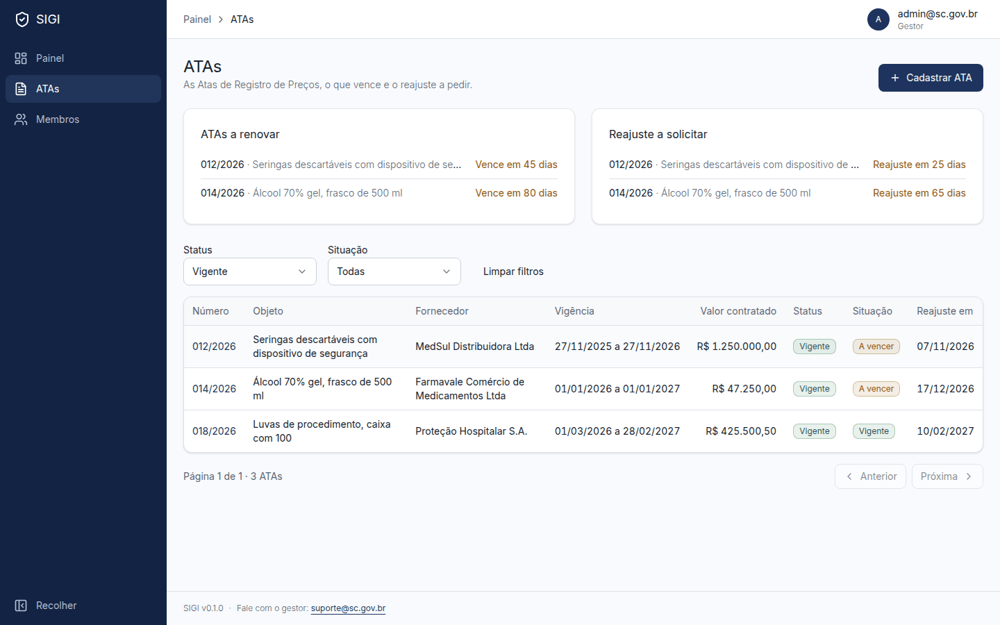

**Empty answers**

| The table reads | When | Offered |
| --- | --- | --- |
| "Nenhuma ATA cadastrada." | No ATA exists | "Cadastrar ATA", to a gestor |
| "Nenhuma ATA com esses filtros." | Filters match nothing | "Limpar filtros" |
| "Nenhuma ATA nesta página." | The address asks for a page past the last | "Voltar à primeira página" |
| "Nenhum vencimento ou reajuste próximo." | Nothing falls due | — |

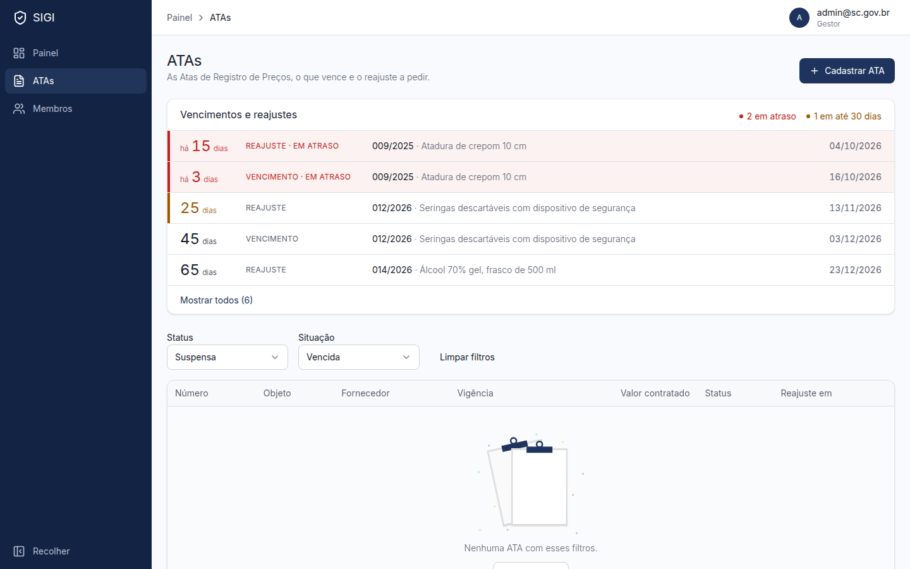

**Loading and failure.** Each block shows a grey skeleton of its own shape
while it loads. If a request fails, that block shows "Não foi possível
concluir. Tente novamente em instantes." with the gestor contact, and never
reads as empty.

---

## 2. Register an ATA (gestor)

**Cadastrar ATA** opens `/atas/nova`, a page with the fields in four sections,
the way the ATA page groups them: **Identificação** (Número, Órgão, Objeto),
**Fornecedor** (CNPJ, Razão social), **Vigência** (Início, Fim, Data de
emissão) and **Valores** (Valor total, Data do orçamento planilhado). "Voltar"
and "Cadastrar" stay at the foot of the screen however far down the page is
scrolled. The ATA is created as a **rascunho**: it counts for nothing until a
gestor activates it. "Voltar" returns to the list and saves nothing.

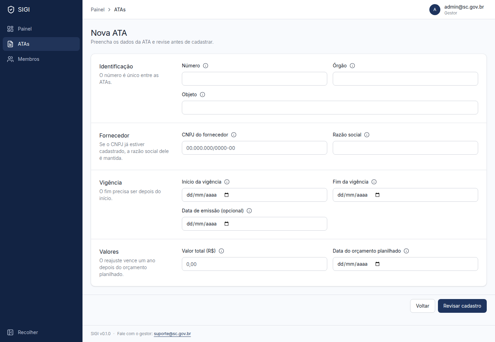

### Fields

| Field | Required | What it accepts | Checked by the screen | Refused by the API with |
| --- | --- | --- | --- | --- |
| Número | Yes | Up to 60 characters, unique among all ATAs | Not empty | "Use no máximo 60 caracteres." · "Já existe uma ATA com este número. Confira o número ou abra a existente." |
| Objeto | Yes | Free text | Not empty | "Campo obrigatório." |
| Órgão | Yes | Up to 200 characters | Not empty | "Use no máximo 200 caracteres." |
| CNPJ do fornecedor | Yes | 14 digits with valid check digits, typed with or without punctuation; shown as 00.000.000/0000-00 while typing | Not empty | "CNPJ inválido." (wrong length, wrong check digits, or all digits equal) |
| Razão social | Yes | Up to 200 characters | Not empty | "Use no máximo 200 caracteres." |
| Data de emissão (opcional) | No | A date | — | "Data inválida." |
| Início da vigência | Yes | A date | Not empty | "Data inválida." |
| Fim da vigência | Yes | A date after Início da vigência | Not empty | "A vigência precisa terminar depois de começar." |
| Valor total (R$) | Yes | More than zero, at most two decimals and 15 digits, typed in pt-BR (`1.234.567,89`) | Not empty | "Informe um valor maior que zero." · "Use no máximo duas casas decimais e 15 dígitos." · "Valor inválido." |
| Data do orçamento planilhado | Yes | A date; the reajuste falls due one calendar year later | Not empty | "Data inválida." |

**The fornecedor is found by its CNPJ.** If a fornecedor with that CNPJ
already exists, the ATA points to it and the Razão social typed is ignored; the
existing one is kept. If none exists, it is created with the Razão social
typed. There is no separate fornecedor screen.

**Money is never rounded.** "10,005" is sent as `10.005` and refused; it is
not turned into 10,01.

### What happens on Cadastrar

1. The screen checks only that every required field is filled. An empty one
   reads "Campo obrigatório." and nothing is sent.

   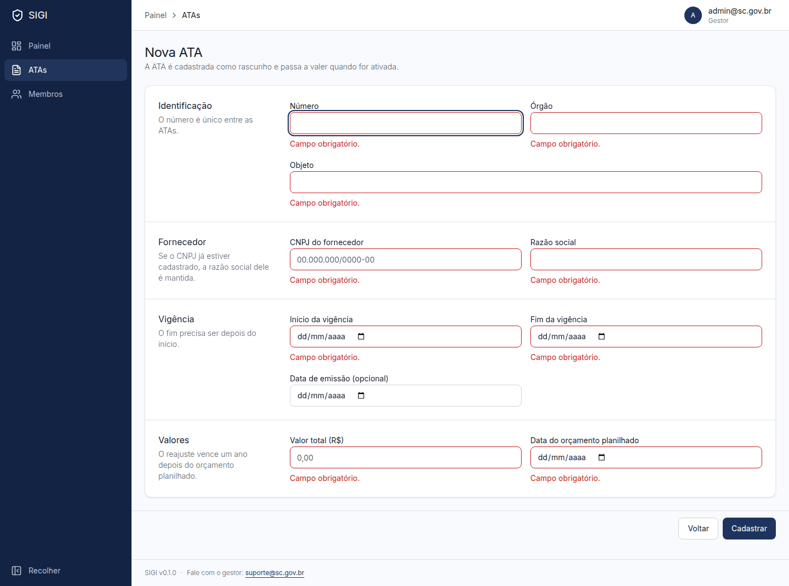

2. The API checks the rest. Each refusal appears under the field it names, the
   field is outlined in red, the cursor moves to the first one, and everything
   typed stays. The API reports schema errors (lengths, formats) all at once,
   and business errors (vigência, CNPJ, número repetido) one at a time, so
   fixing one may reveal the next.

   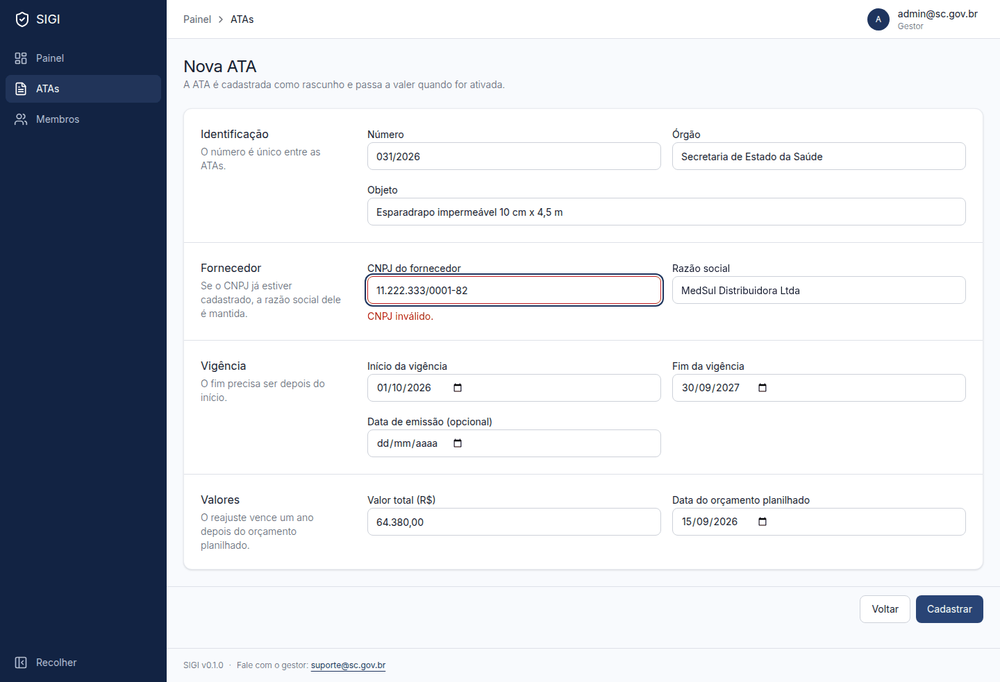

   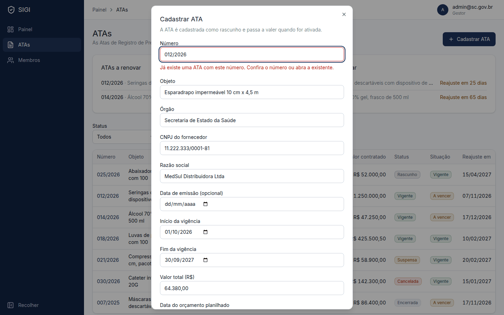

3. On success the ATA's page opens with "ATA cadastrada como rascunho."

   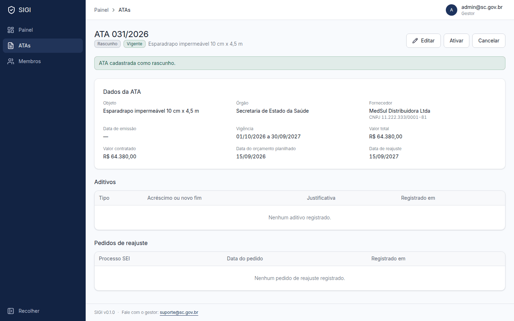

---

## 3. Open an ATA

From a row, an alert, or the address `/atas/{id}`.

The header shows the número, the Status and Situação badges and the objeto.
**Dados da ATA** shows Objeto, Órgão, Fornecedor (razão social and CNPJ), Data
de emissão, Vigência, Valor total, Valor contratado, Data do orçamento
planilhado and Data de reajuste. Below come **Aditivos** and **Pedidos de
reajuste**.

- **Valor contratado** is Valor total plus every aditivo de valor.
- **Data de reajuste** is one calendar year after Data do orçamento planilhado
  (an orçamento of 29/02 falls due on 28/02).
- Dates are calendar dates and read the same in any browser time zone.

An address that matches no ATA reads "ATA não encontrada." with **Voltar para
ATAs**.

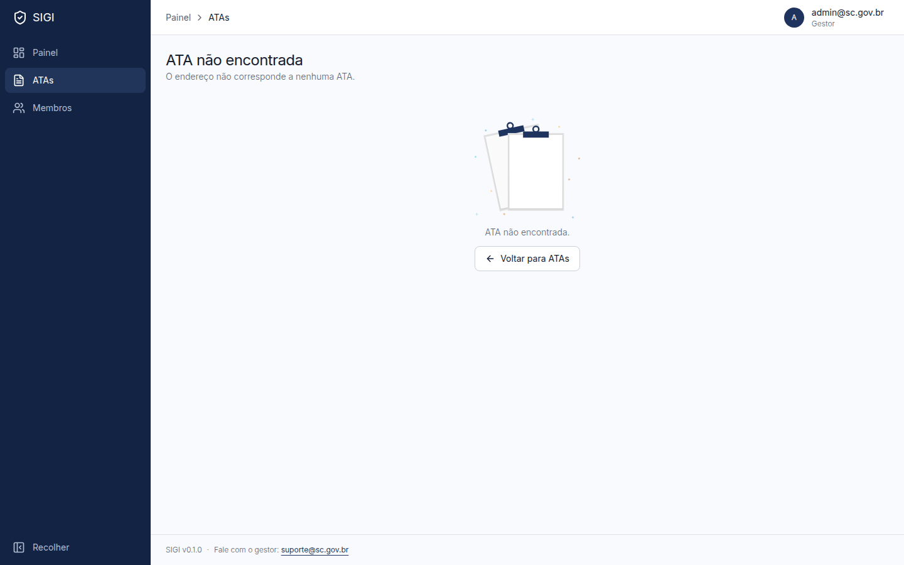

---

## 4. Edit an ATA (gestor)

**Editar** opens `/atas/{id}/editar`, the registration page filled in. Only the
fields that changed are sent; on success the ATA's page opens with "ATA
atualizada.". "Voltar" returns to the ATA and saves nothing.

| Status | What can be edited |
| --- | --- |
| Rascunho | Every field, including Número, the fornecedor, the dates and the valor |
| Vigente, Suspensa, Encerrada, Cancelada | Objeto and Órgão only |

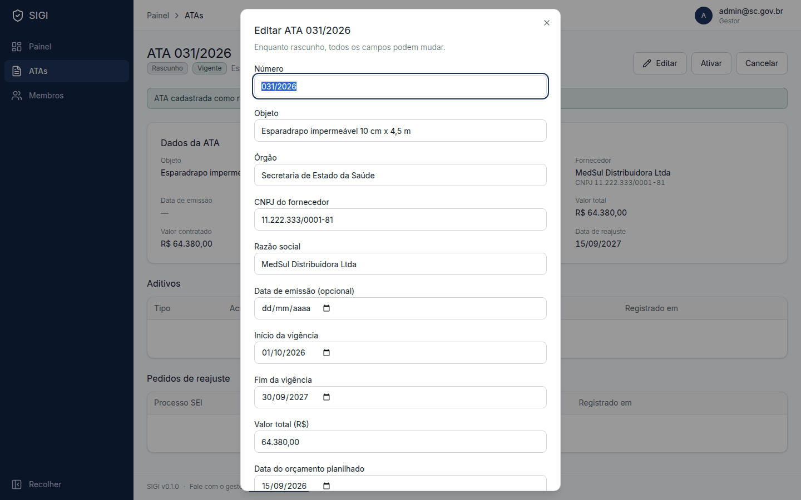

After activation the other fields are shown greyed out, with "Depois de
ativada, valores e prazos só mudam por aditivo." The contracted figures change
only through an aditivo, so what was contracted is never overwritten. If the
API refuses an edit because the ATA changed meanwhile (`ATA_NAO_EDITAVEL`), the
message shows on the page and the form reloads the ATA as it now is.

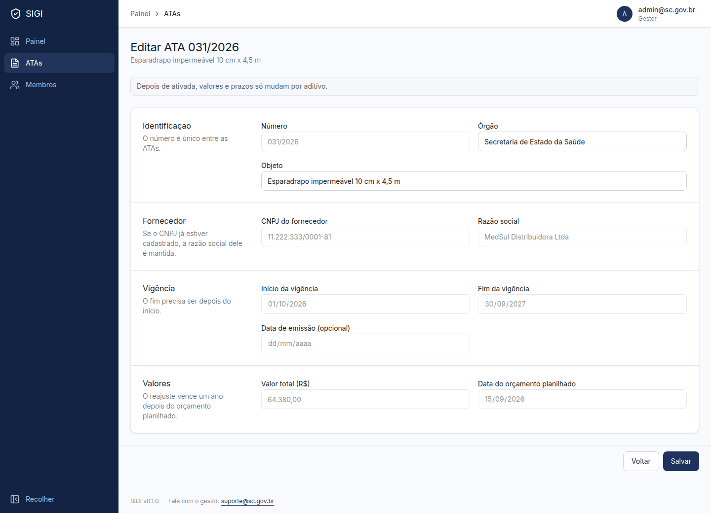

The same field rules as registration apply; a refusal lands on its field.

---

## 5. Change the status (gestor)

The buttons in the header follow the status. Each asks for confirmation,
naming the ATA and what the move does.

| Status | Buttons offered | Result |
| --- | --- | --- |
| Rascunho | Ativar, Cancelar | Ativar → Vigente |
| Vigente | Suspender, Encerrar, Cancelar | Suspender → Suspensa · Encerrar → Encerrada |
| Suspensa | Retomar, Encerrar, Cancelar | Retomar → Vigente · Encerrar → Encerrada |
| Encerrada | None | Final |
| Cancelada | None | Final |

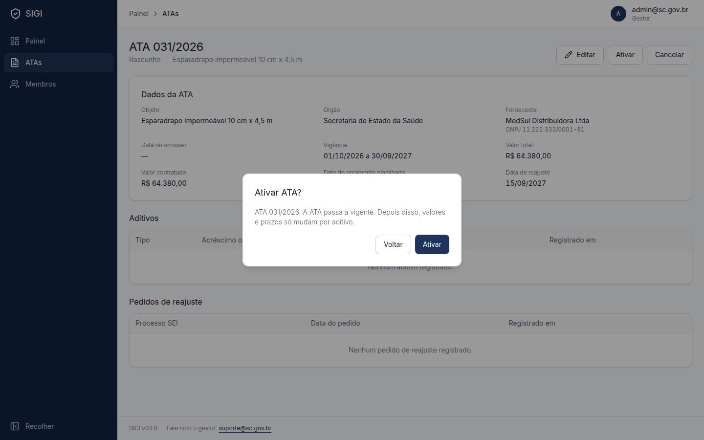

On success the badge changes and the page says "ATA ativada.", "ATA
suspensa.", "ATA retomada.", "ATA encerrada." or "ATA cancelada.".

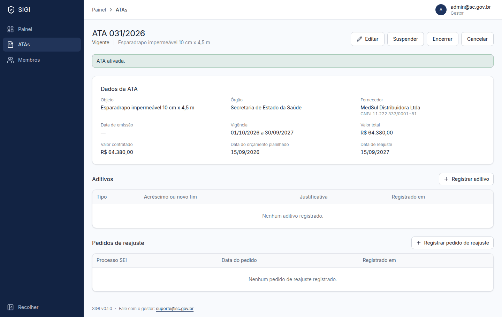

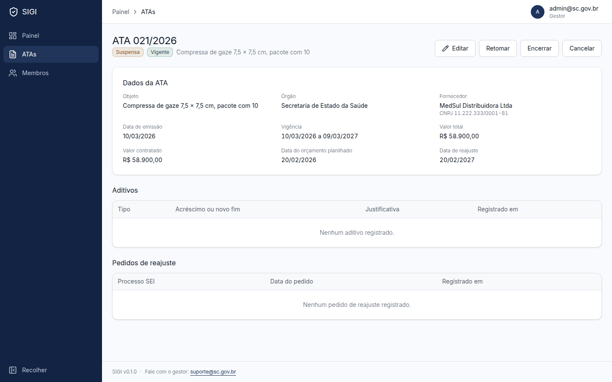

**Cancelar** asks for a **Justificativa** (up to 500 characters). "Cancelar
ATA" stays disabled until one is typed. The justificativa is recorded in the
audit trail. The confirmation's own close button reads "Voltar", because
"Cancelar" is the move.

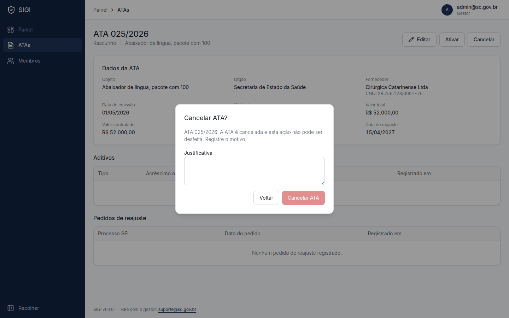

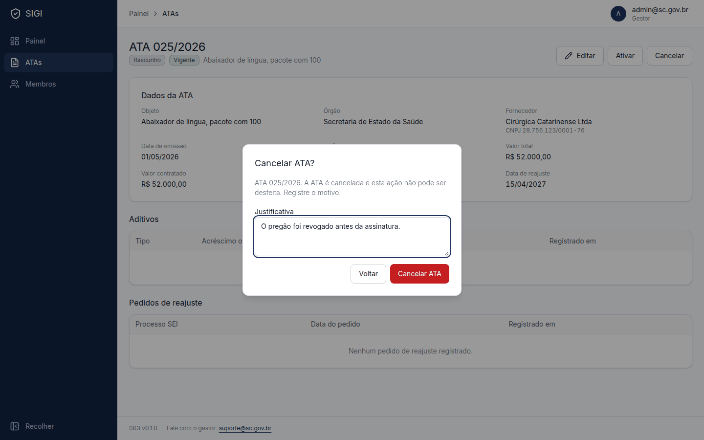

Encerrar and Cancelar cannot be undone. An encerrada or cancelada ATA offers no
move, and Editar there changes only Objeto and Órgão.

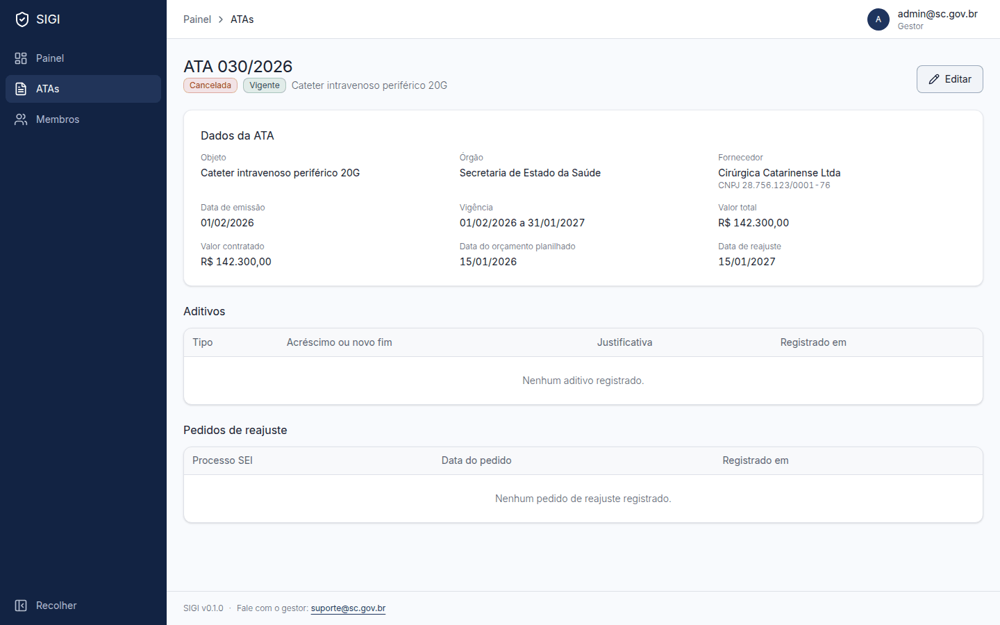

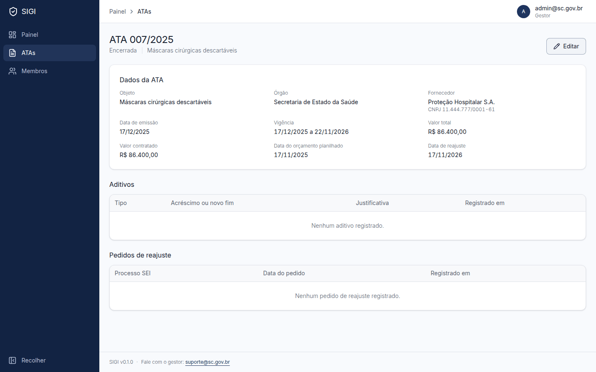

**If someone else moved the ATA first** (for example it was suspended in
another tab), the API refuses with "Esta ATA não pode passar de {origem} para
{destino}.", the message stays in the open confirmation, and the page reloads
the ATA with its real status.

---

## 6. Register an aditivo (gestor, vigente ATA only)

**Registrar aditivo** in the Aditivos section. Not offered unless the ATA is
vigente; a suspended ATA must be resumed first.

| Field | Required | Accepts | Refused with |
| --- | --- | --- | --- |
| Tipo | Yes | Valor or Prazo | — |
| Acréscimo (R$), for Valor | Yes | More than zero, pt-BR money | "Informe um valor maior que zero." · "O aditivo passa de 25% do valor original da ATA. Reduza o valor." |
| Novo fim da vigência, for Prazo | Yes | A date after the current Fim da vigência | "Informe uma data depois do fim atual." |
| Justificativa | Yes | Up to 500 characters | "Campo obrigatório." |

**The 25% ceiling is cumulative over the original Valor total.** An ATA of
R$ 64.380,00 accepts at most R$ 16.095,00 in aditivos de valor over its whole
life; R$ 20.000,00 at once is refused, and so would be a second aditivo that
takes the sum past it. The API computes this; the screen does not.

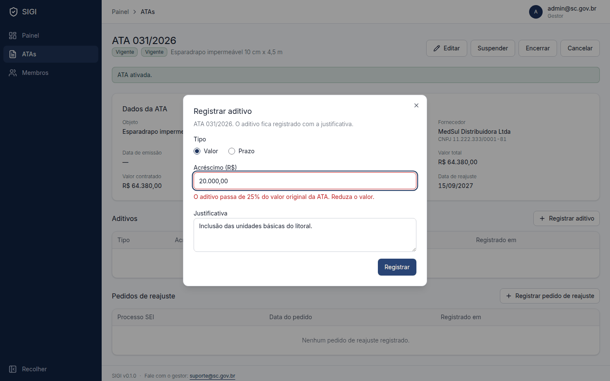

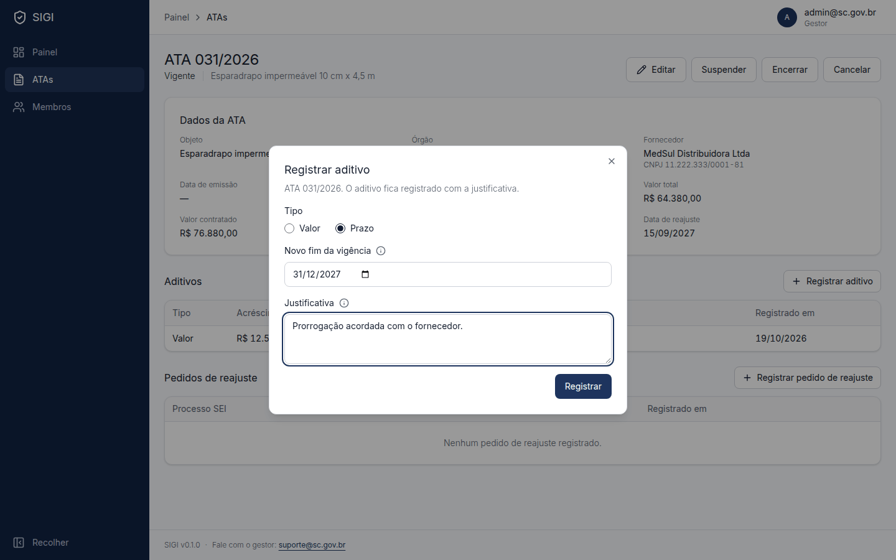

On success the aditivo appears in the table and the page says "Aditivo
registrado.". An aditivo de valor raises Valor contratado; an aditivo de prazo
moves Fim da vigência and takes its Vencimento row out of **Vencimentos e reajustes**. Aditivos
cannot be edited or removed.

---

## 7. Register a pedido de reajuste (gestor, vigente ATA only)

The reajuste itself is requested in SEI, outside SIGI. SIGI records that it was
filed and under which process. **Registrar pedido de reajuste** in the Pedidos
de reajuste section; not offered unless the ATA is vigente.

| Field | Required | Accepts | Refused with |
| --- | --- | --- | --- |
| Processo SEI | Yes | The format `NNNNN.NNNNNN/AAAA-DD`, for example `00412.005120/2026-07` | "Número de processo SEI inválido. Use o formato NNNNN.NNNNNN/AAAA-DD." |
| Data do pedido | Yes | A date, today by default | "Data inválida." |

Only the format is checked; SIGI does not look the process up in SEI.

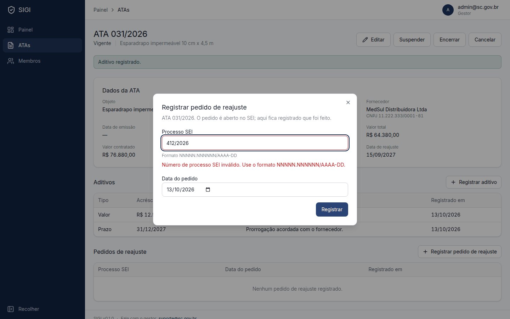

On success the pedido appears in the table, the page says "Pedido de reajuste
registrado.", and its Reajuste row leaves **Vencimentos e reajustes**. Recording a pedido
changes no price.

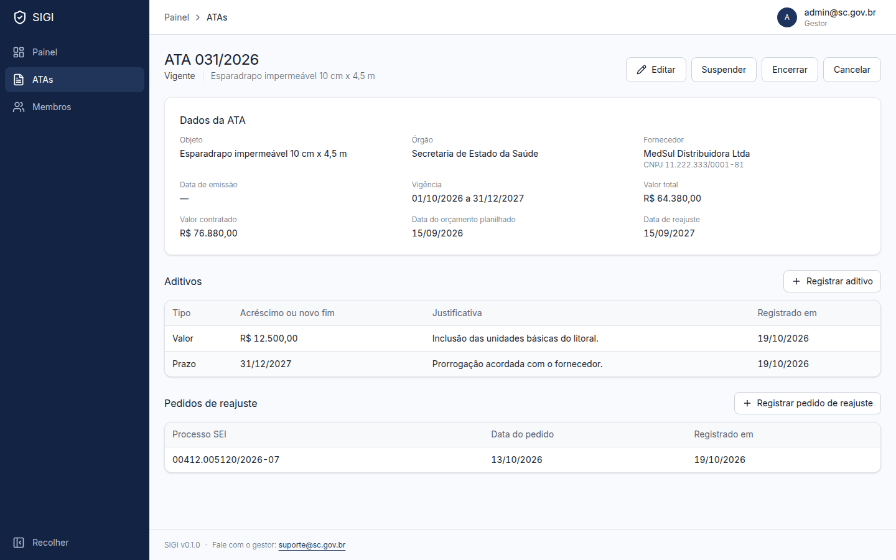

---

## 8. Delete an ATA

**Not possible, for anyone.** No screen offers it, and the API answers
`405 Method Not Allowed` to a DELETE. An ATA registered by mistake is
**cancelled** with a justificativa (section 5), which keeps it and its history.
An aditivo or a pedido de reajuste cannot be deleted either.

---

## 9. Servidor and auditor

The same list, alerts and ATA pages, with no Cadastrar, Editar, move, aditivo
or reajuste control.

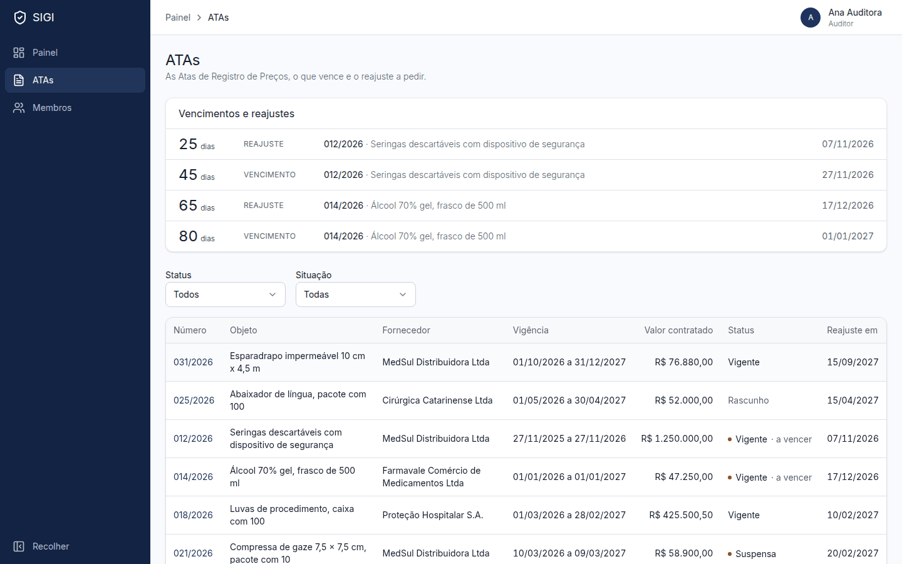

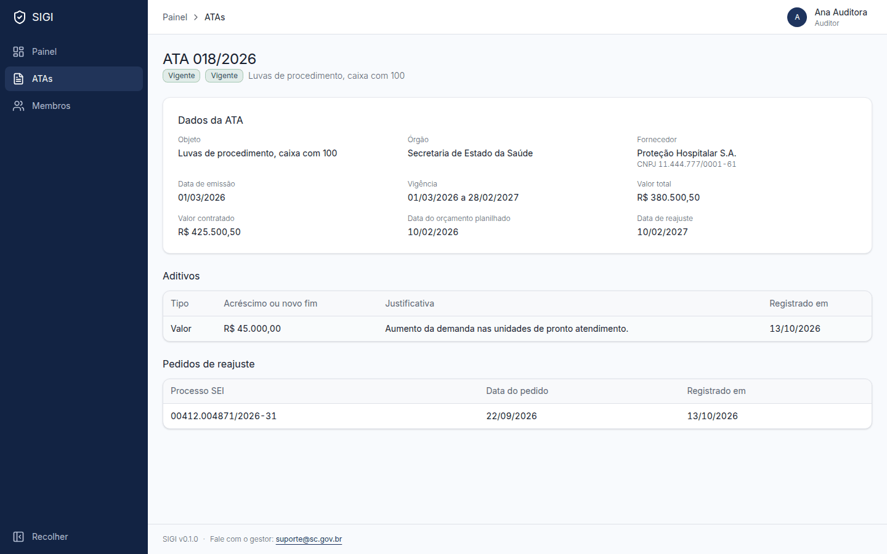

---

## 10. On a phone

The header actions stack, the filters take the full width, and a wide table
scrolls sideways inside its own frame; the page itself never does.

| List | ATA |
| --- | --- |
| 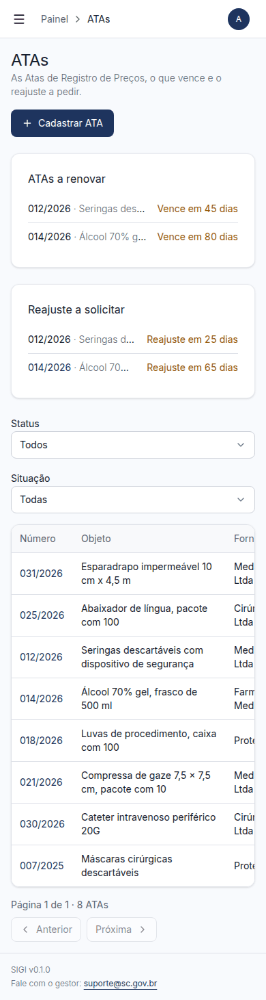 | 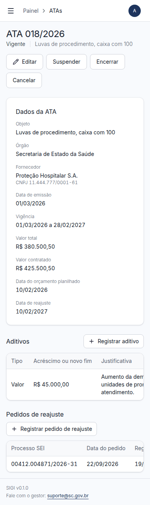 |

---

## Errors that can happen anywhere

| What the person sees | Why | What to do |
| --- | --- | --- |
| "Não foi possível concluir. Tente novamente em instantes." with the gestor contact | The API did not answer, or failed | Try again; if it persists, contact the gestor with the reference shown |
| "Seu perfil não permite esta ação." | The perfil changed while the page was open | Reload the page |
| The login page, with the reason | The session expired | Sign in again; the page returns to where it was |

## Not on these screens yet

- **Saldo, valor empenhado and % consumido.** They come from the Notas de
  Empenho (SPEC-0004, SPEC-0006).
- **The ATA's items** and their CSV import (SPEC-0003).
- **Changing the responsável.** The API accepts it; the screen needs a way to
  choose a member first.
- **The ATA's audit history** on screen (SPEC-0007). Every action above is
  already recorded in it.
